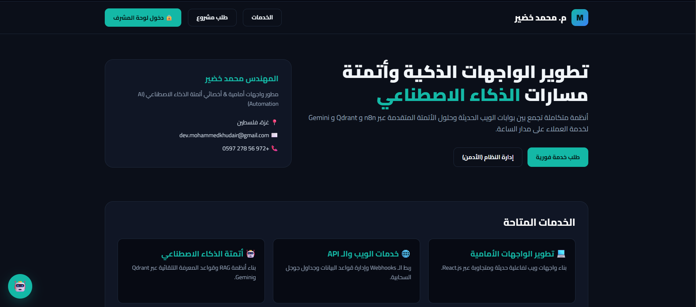
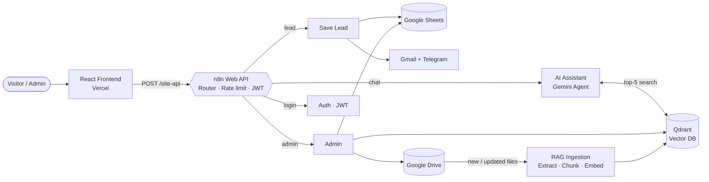
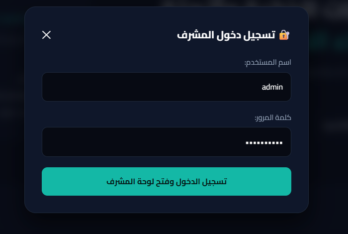
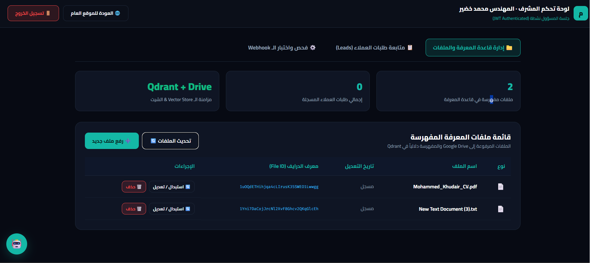
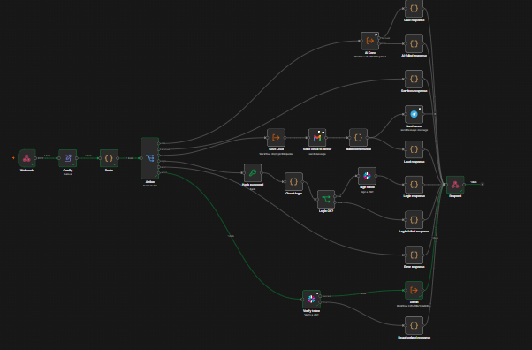
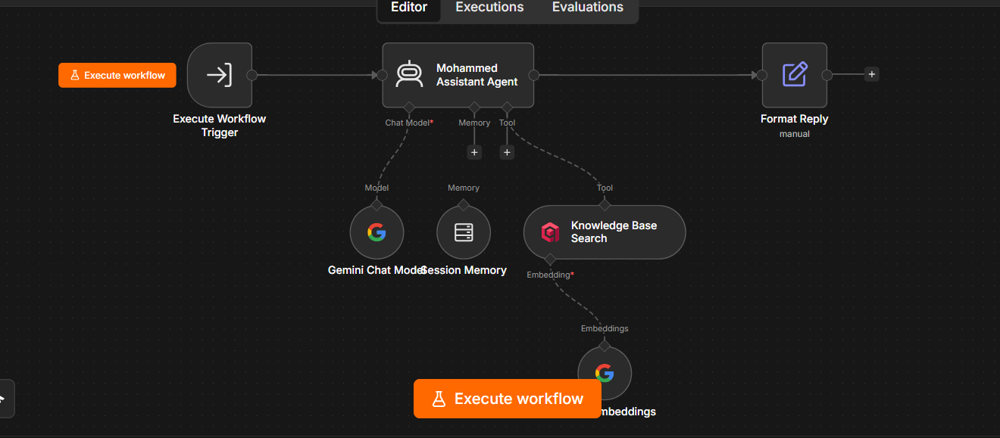
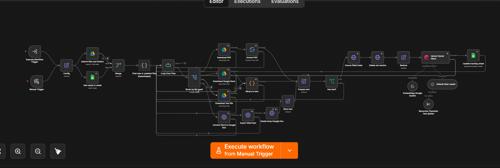
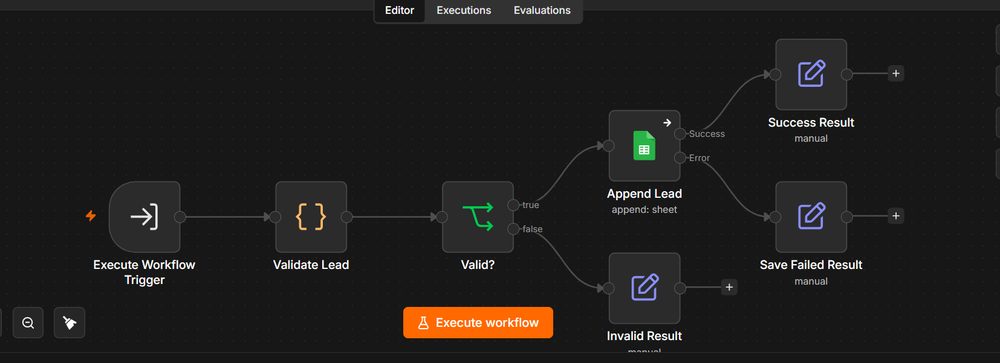
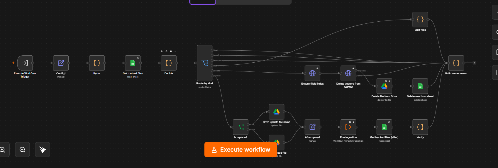

# 🤖 Persona AI

### An AI-powered personal website with a RAG assistant, lead capture, and a secure admin panel — fully automated with n8n

[**🌐 Live Demo**](https://persona-website-mlux.vercel.app) · [**📸 Screenshots**](#-screenshots) · [**🏗 Architecture**](#-architecture)

---

## 📌 Overview

**Persona AI** turns a static portfolio website into an always-on assistant for the site owner.
Visitors can chat with an AI that answers **only from the owner's own documents** (CV, services, projects, pricing), request a service, and the owner manages everything from a protected dashboard — with **no code changes** needed to update the assistant's knowledge.

The entire backend is built as **5 connected n8n workflows (~85 nodes)** exposed through a single secured webhook.

> **Note:** This repository is a **portfolio showcase** (documentation + screenshots). Workflow exports and credentials are intentionally not published.

## ✨ Features

| | Feature | Details |
|---|---|---|
| 💬 | **RAG chat assistant** | Gemini agent that searches a Qdrant knowledge base before every answer; replies in the visitor's language (Arabic / English) |
| 🚫 | **Hallucination guard** | The assistant is instructed to never invent facts or prices — if the answer isn't in the knowledge base, it offers direct contact |
| 📥 | **Lead capture** | Validated form → saved to Google Sheets with a unique lead ID → owner notified by Gmail + Telegram |
| 🗂 | **Knowledge-base management** | Upload, replace, and delete documents from the dashboard; Drive, Qdrant, and the tracking sheet stay in sync automatically |
| 🔐 | **Secure admin panel** | JWT sessions, salted SHA-256 password hashing, login lockout, and rate limiting |
| 🌍 | **Arabic-first UI** | Responsive RTL interface with a dark theme |

## 🏗 Architecture

## ⚙️ Workflows

| # | Workflow | Responsibility |
|---|----------|----------------|
| 1 | **Web API** | Single webhook entry point. Routes `chat`, `services`, `lead`, `login`, and `admin` actions; enforces rate limiting, login lockout, and JWT verification |
| 2 | **AI Assistant** | Gemini-powered agent (temperature 0.3) with a Qdrant retrieval tool. Strict system prompt: answer from retrieved knowledge only |
| 3 | **RAG Ingestion** | Detects new/updated files in Drive, extracts text (PDF, Google Docs, TXT, Word), splits it into chunks, embeds with Gemini, and stores vectors in Qdrant |
| 4 | **Save Lead** | Validates name, phone, and service; appends to Google Sheets; returns a unique lead ID |
| 5 | **Admin** | List / upload / replace / delete knowledge files; removes vectors, Drive file, and sheet row together to avoid orphaned data |

## 📸 Screenshots

### Admin panel

| Login | Knowledge base dashboard |
|:---:|:---:|
|  |  |

### n8n workflows

**Web API** — routing, security, and notifications

**AI Assistant** — Gemini agent + Qdrant retrieval tool

**RAG Ingestion** — from Drive files to vectors

**Save Lead** — validate, store, respond

**Admin** — knowledge-base management and sync

## 🔐 Security Highlights

- **Rate limiting** — 60 requests per minute per IP
- **Brute-force protection** — 5 failed logins lock the IP out for 15 minutes
- **JWT authentication** — admin sessions expire after 12 hours; every admin action verifies the token
- **Password hashing** — salted SHA-256, no plain-text credentials in the workflow logic
- **Input validation** — message length limits, lead field validation, HTML escaping in notifications
- **Prompt hardening** — the assistant never reveals its instructions or internal tools

## 🧰 Tech Stack

| Layer | Technology |
|-------|------------|
| Frontend | React.js, RTL Arabic UI, Vercel |
| Automation / Backend | n8n (webhook API, sub-workflows) |
| LLM & Embeddings | Google Gemini |
| Vector database | Qdrant |
| Storage & data | Google Drive, Google Sheets |
| Notifications | Gmail, Telegram |
| Auth | JWT, SHA-256 + salt |

## 💡 What I Built & Learned

- Designing a **RAG pipeline end-to-end**: ingestion, chunking, embeddings, retrieval, and prompt-level grounding
- Keeping **three systems in sync** (Drive, Qdrant, Sheets) across upload, replace, and delete operations
- Building a **secure API layer** on top of n8n with rate limiting, lockout, and JWT
- Structuring a large automation as **small, reusable sub-workflows** instead of one giant flow

<b>🇵🇸 نبذة بالعربي</b>

**Persona AI** هو موقع شخصي ذكي يحوّل معرض الأعمال التقليدي إلى مساعد يعمل على مدار الساعة. يجيب المساعد عن أسئلة الزوار **من ملفات المالك فقط** (السيرة الذاتية، الخدمات، الأسعار)، ويستقبل طلبات العملاء ويحفظها تلقائياً، بينما يدير المالك قاعدة المعرفة من لوحة تحكم آمنة بدون أي تعديل في الكود.

**أبرز ما في المشروع:**
- مساعد ذكي بتقنية RAG باستخدام Gemini و Qdrant
- 5 Workflows مترابطة في n8n (حوالي 85 Node)
- تسجيل طلبات العملاء في Google Sheets مع إشعار فوري عبر Gmail و Telegram
- لوحة مشرف محمية بـ JWT مع حماية من التخمين وتحديد معدل الطلبات
- مزامنة تلقائية بين Google Drive و Qdrant و Google Sheets

---

## 👤 Author

**Mohammed Khudair** — Front-end Developer & AI Automation Specialist

- 🌐 Website: [persona-website-mlux.vercel.app](https://persona-website-mlux.vercel.app)
- ✈️ Telegram: [@hamood_kh7](https://t.me/hamood_kh7)
- 💼 GitHub: [@your-username](https://github.com/your-username) <!-- TODO: replace with your GitHub username -->

⭐ If you found this project interesting, feel free to star the repo!

